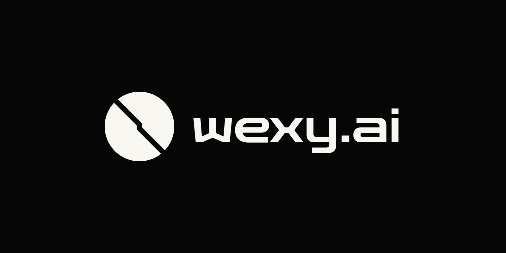

# Wexy

<p align="center">
  
</p>

**Describe a world. Watch it run on your graphics card. Film it.**

Wexy is the website: a browser studio for creating, exploring and filming living 3D worlds.
Meta's models plan the world and write constrained GPU functions; Wexy checks the output
before rendering it through NullGraph on the viewer's graphics card. Choose a camera view,
adjust supported controls, capture a still, or export a wide, vertical or square video.

**For judges:** the demo video and this public repository are the primary evaluation material.
A hosted deployment is optional, not a setup dependency. You can run the site locally using
the steps below without the author's Firebase account, secret manager or private notes.
Actual live generation requires your own authorized Meta API credentials and can incur charges.
The no-key routes below do not substitute for live Meta-call evidence in the submission video.

## Contents

- [What the product does](#what-the-product-does)
- [Choose an evaluation mode](#choose-an-evaluation-mode)
- [Prerequisites](#prerequisites)
- [1. Clone and run the no-key playground](#1-clone-and-run-the-no-key-playground)
- [2. Run the local backend without paid calls](#2-run-the-local-backend-without-paid-calls)
- [3. Enable real Meta generation intentionally](#3-enable-real-meta-generation-intentionally)
- [Walk through the product](#walk-through-the-product)
- [Configuration reference](#configuration-reference)
- [Tests and builds](#tests-and-builds)
- [Troubleshooting](#troubleshooting)
- [Optional hosting and credit protection](#optional-hosting-and-credit-protection)
- [Architecture and repository layout](#architecture-and-repository-layout)
- [Status, provenance and license](#status-provenance-and-license)

## What the product does

- **Create:** turn an idea into a scene plan and model-authored GPU function bodies. The
  engine-aware authoring path also builds a checked program and its modules.
- **Check before running:** structured contracts and execution checks gate installation;
  unchecked output does not silently replace the existing world.
- **Explore:** move the camera and use controls supported by the running world. A model-generated
  world is not simply a pre-rendered video.
- **Capture:** take stills and use **Make a video** to choose format, quality and length,
  render the shot, preview the completed MP4 and save it. Browser/GPU/codec support matters.
- **Inspect:** Developer view exposes generation evidence, call diagnostics and candidate checks.
- **Try without credits:** hand-written playground worlds let you explore rendering and capture
  without a model call. The backend also has a separate recorded mock transport for testing.

Rendering and film encoding happen on your device. Live prompts and model requests go through
the backend and Meta; local rendering does **not** make generation entirely offline or private.
Controls vary by world. Generation quality and supported engine coverage are not universal.

## Choose an evaluation mode

| Mode | What you can evaluate | Needs | Paid Meta calls? |
|---|---|---|---|
| **Browser playground** | Hand-written examples, camera, stills and video capture | Frontend + WebGPU browser | **No** |
| **Local mock backend** | Gateway/service integration and recorded plan/author/repair flows | Frontend, Java, Redis; MariaDB/platform for accounts | **No**; fixture responses are not live inference |
| **Live Meta backend** | Real generation through the implemented authoring paths | Local stack + your Meta API key and credit | **Yes** |

Mock transport covers its recorded scenarios, not arbitrary prompts or every newer agent/review
route. The UI's source labels distinguish playground, live and saved/replayed results; backend
mock mode still uses the real HTTP client path, so check the active backend profile as well.

## Prerequisites

| Requirement | Used for |
|---|---|
| Git | Clone the public repository |
| Node.js **24.12.0 or newer** and npm | Frontend tools; use the lockfile with `npm ci` |
| Desktop Chrome or Edge with WebGPU and hardware acceleration | Running worlds; export also needs supported WebCodecs/storage |
| **JDK 21** with `JAVA_HOME` configured | Backend services; Maven is supplied by the wrapper |
| Docker with Compose | Local Redis **7.2**, MariaDB **11.4**, and strict integration tests |
| Authorized Meta Model API access | Live generation only |

For the playground alone, Java, Docker, Meta credentials and Firebase are unnecessary.
Dependency installation needs internet access. Use localhost or HTTPS, not `file://`.
Optional Firebase Hosting metadata Functions have a separate **Node 22** runtime; they are
not needed for local Vite evaluation. There is no WebGL fallback.

## 1. Clone and run the no-key playground

```sh
git clone https://github.com/flarelink-in/wexy.git
cd wexy
cd "wexy frontend"
npm ci
npm run dev -- --host 127.0.0.1 --port 5173 --strictPort
```

Open `http://localhost:5173`. The studio is `http://localhost:5173/studio.html`.
For an explicit no-model example, open:

```text
http://localhost:5173/studio.html?source=mock&scene=kerr-black-hole
```

The featured Black Hole, Magnetar and Storm examples are hand-written playground scenes,
not model output. Move the camera, try available controls, then open **Make a video** and
start with a short, lower-quality export. Play and save the completed file.

No `.env` file is required for this mode. If your environment already provides a gateway,
the explicit `source=mock` route keeps creation on the playground client. Loading an example
does not prove live inference. Stop Vite with **Ctrl+C**.

## 2. Run the local backend without paid calls

### A. Prepare infrastructure and install the Java modules

Open a terminal at the repository root. Folder names contain spaces; keep the quotes.

**macOS/Linux/Git Bash:**

```sh
cd "wexy backend"
docker compose -f compose.local.yaml up -d
docker compose -f compose.local.yaml ps
./mvnw -B install -DskipTests
```

**Windows PowerShell:**

```powershell
cd "wexy backend"
docker compose -f compose.local.yaml up -d
docker compose -f compose.local.yaml ps
.\mvnw.cmd -B install '-DskipTests'
```

Wait for MariaDB to become healthy before starting the platform service. Redis is published
on loopback **6390**, MariaDB on **3316**, using Compose's non-secret local-development credentials.
The install step builds and installs shared modules but skips test execution; it is not a
validation pass. The Maven wrapper downloads Maven on its first run.

### B. Start three services in separate terminals

Run each command from the repository's `wexy backend` directory, and leave it running.

| Terminal | macOS/Linux/Git Bash |
|---|---|
| Gateway | `./mvnw -pl forge-gateway spring-boot:run -Dspring-boot.run.profiles=local -Dspring-boot.run.arguments=--server.address=127.0.0.1` |
| Forge, **mock** | `./mvnw -pl forge-service spring-boot:run -Dspring-boot.run.profiles=local,mock -Dspring-boot.run.arguments=--server.address=127.0.0.1` |
| Platform/accounts | `./mvnw -pl platform-service spring-boot:run -Dspring-boot.run.profiles=local -Dspring-boot.run.arguments=--server.address=127.0.0.1` |

PowerShell equivalents, again one per terminal:

```powershell
.\mvnw.cmd -pl forge-gateway spring-boot:run '-Dspring-boot.run.profiles=local' '-Dspring-boot.run.arguments=--server.address=127.0.0.1'
```

```powershell
.\mvnw.cmd -pl forge-service spring-boot:run '-Dspring-boot.run.profiles=local,mock' '-Dspring-boot.run.arguments=--server.address=127.0.0.1'
```

```powershell
.\mvnw.cmd -pl platform-service spring-boot:run '-Dspring-boot.run.profiles=local' '-Dspring-boot.run.arguments=--server.address=127.0.0.1'
```

The gateway listens on **8400**, forge on **8410**, and platform on **8430**. The mock model
transport runs on loopback **8420**. Mock mode does not require a real API key and makes no
paid Meta calls, but it still exercises Redis-backed metering and can hit configured caps.
The platform service is needed for account/profile operations; do not omit it for a full-site
review even though basic rendering and some forge operations can run independently.

### C. Connect Vite to the gateway

In `wexy frontend`, copy the public configuration template, without overwriting an existing
local configuration you need:

```sh
cp .env.example .env.local
```

PowerShell: `Copy-Item .env.example .env.local`.

Keep `VITE_API_ORIGIN=http://localhost:8400`. Leave `VITE_FIREBASE_API_KEY`,
`VITE_FIREBASE_APP_ID` and `VITE_APPCHECK_SITE_KEY` empty for local evaluation. Do not supply
a Firebase service account to the backend in this mode. The development build and local
gateway use a loopback-only development identity; no Firebase login/project is required.

Start/restart Vite after changing environment values:

```sh
npm run dev -- --host 127.0.0.1 --port 5173 --strictPort
```

Open `http://localhost:5173/studio.html?legacy=1` **without** `source=mock` to exercise the
backend's recorded legacy flow. Use a featured prompt corresponding to a recorded example,
such as the black-hole starter. An arbitrary new idea is not meaningful mock-model testing.
Local **Sign in** simulates a provider transition; it is not real Google authentication.

### D. Readiness and shutdown

Check each service's startup log and health endpoint:

```sh
curl http://localhost:8400/actuator/health
curl http://localhost:8410/actuator/health
curl http://localhost:8430/actuator/health
```

PowerShell can use `Invoke-RestMethod http://localhost:8400/actuator/health` and the other ports.
A healthy service is not proof of a successful GPU run or model call.

Stop Vite/services with **Ctrl+C** in their terminals. From `wexy backend`, stop containers with:

```sh
docker compose -f compose.local.yaml down
```

This preserves named volumes. **Do not add `-v` casually:** deleting volumes removes local
account data and spend/allowance counters. Never erase a live meter to get around its limits.

## 3. Enable real Meta generation intentionally

Keep Redis, platform, gateway and Vite running as above. Stop the mock forge process first;
only one forge service can use port 8410. Review the configuration and credit limits before
starting a real request. Do not run live harnesses just to check installation.

In the forge terminal, provide `WEXY_META_API_KEY` through your secret manager or a private
environment variable. Alternatively, the backend's `local` profile imports an ignored
`wexy backend/.env` file containing `KEY=value` entries. Use a private editor to set the key;
do not put it directly in a shell command that will be retained in history. Do not commit
the file or copy it into the frontend. Start forge with **`local`, not `local,mock`**:

```sh
./mvnw -pl forge-service spring-boot:run -Dspring-boot.run.profiles=local -Dspring-boot.run.arguments=--server.address=127.0.0.1
```

```powershell
.\mvnw.cmd -pl forge-service spring-boot:run '-Dspring-boot.run.profiles=local' '-Dspring-boot.run.arguments=--server.address=127.0.0.1'
```

Use your provider's authorized endpoint; the configured default is `https://api.meta.ai/v1`.
The checked-in roles use **`muse-spark-1.3`** for planning, authoring, agent/module work and
review, with **`muse-wonder-1.0`** for escalation. Availability depends on your account; inspect
`wexy backend/forge-service/src/main/resources/application.yaml` rather than assuming access.
Do not change models without checking their input/output and reasoning-setting compatibility.

Open one of the following routes:

| Route on `http://localhost:5173` | Purpose |
|---|---|
| `/studio.html?legacy=1` | Existing plan/author/check creation path |
| `/studio.html?create=agent` | Opt-in engine-aware creator path: **Create world**, checks, then **Show it** |
| `/studio.html?create=agent&agent=1` | Same creator path with Developer diagnostics |

The agent creator is still opt-in in this checkout; it is not the unflagged default. Its
checked hand-off, module build and device admission are separate stages. Press **Show it**
when offered; a static verdict alone is not proof the world has rendered. Generated requests
can fail validation or exceed this device's admitted workload; report that rather than treating
a preset as a successful generated result.

**Spending controls:** configuration is in micro-USD (`1,000,000 = $1`). The checked-in
global daily/monthly ceilings are **$15/$40**, with provider and lane caps inside them.
These are project defaults, not an estimate or a safe budget recommendation for your account.
For example, set `WEXY_SPEND_GLOBAL_DAILYMICROUSD` and
`WEXY_SPEND_GLOBAL_MONTHLYMICROUSD` to your deliberate limits before starting forge. Reservations
can refuse a request before the nominal balance is exhausted. Lower caps can make larger
agent turns unavailable. Mock runs also consume local meter counters.

Prompt allowances are separate from dollar caps: the current defaults include one anonymous
creation per account/network, one early-access creation per day and an admin lane. Do not
expect unlimited retries. Keep the counters intact and inspect the denial rather than
disabling protections. The local profile uses recorded content-safety verdicts, not the
production Azure moderation service; it must never be exposed publicly.

Visual model review has additional vision-probe, image-metering and consent gates. It is not
enabled merely by supplying the API key. Leave those gates closed unless separately verified.
Remove the live credential when finished; restarting with `local,mock` restores no-paid-call mode.

## Walk through the product

1. Open the landing page, then choose a playground example or enter the studio.
2. In live mode, describe an idea and start creation. Keep the progress/source information visible.
3. If using the agent creator, wait for checks and choose **Show it** when offered.
4. Move the camera on the resulting world. Adjust only controls that world exposes.
5. Capture a still, or open **Make a video**, choose format/quality/length and render a short shot.
6. Wait for completion, play the actual result, then save/share the file where supported.
7. For model-use inspection, open Developer view and correlate call diagnostics with the generated
   program/modules and running result. Backend-side evidence establishes real upstream calls.

Use source labels honestly: a playground is hand-written, a backend mock is a recording/fixture,
and an earlier saved attempt is a replay. File export/sharing is not a durable public world URL.

## Configuration reference

| Setting / file | Meaning |
|---|---|
| `wexy frontend/.env.example` | Public browser settings; copy to ignored `.env.local` for Vite |
| `VITE_API_ORIGIN` | Gateway origin, no trailing slash; local default `http://localhost:8400` |
| `VITE_FIREBASE_*` | Public Firebase web-app configuration; keep the API key empty for local dev identity |
| `VITE_APPCHECK_SITE_KEY` | Public App Check site key; empty for local development |
| `wexy backend/.env.example` | Server configuration names and safe empty/default values, not credentials |
| `WEXY_META_API_KEY` | Secret, forge only; required for real calls |
| `WEXY_META_API_BASE_URL` | Server-side provider endpoint; never route secrets through the browser |
| `REDIS_HOST` / `REDIS_PORT` | Local meter/limit store, default `localhost:6390` |
| `WEXY_GATEWAY_URL` | Forge's gateway/JWKS origin, default `http://localhost:8400` |
| `WEXY_FORGE_SERVICE_URL` / `WEXY_PLATFORM_SERVICE_URL` | Gateway upstreams, defaults `http://localhost:8410` / `http://localhost:8430` |
| `WEXY_SPEND_*` | Global/provider/lane budget overrides; inspect the service YAML for full keys |

Every `VITE_*` value can reach the browser bundle. Never put a Meta key, service-account JSON,
internal signing key, bearer token or App Check debug token there. Backend processes do not
read Vite's `.env.local`; Vite does not configure the backend. Shell environment variables can
override file values, so check for inherited production credentials before local startup.
Secret-manager tooling is optional for local setup, not an untracked installation prerequisite.

## Tests and builds

From `wexy frontend`:

```sh
npm test                 # Headless contracts, clients, controllers and runtime-related checks
npm run contrast         # Configured colour-pair checks
npm run typecheck        # TypeScript only
npm run build            # Type-check + Vite build + hosting artifact preparation; no deployment
npm run verify           # Tests, contrast and build
npm run preview -- --host 127.0.0.1
```

Preview serves the built site, normally on port **4173**; check Vite's printed address. Use it
for static/playground review. The local dev identity is development-build-only, and the gateway's
local CORS configuration admits port 5173, so do not expect preview to be a drop-in authenticated
local backend test. Use `npm run dev` for that integration.

From `wexy backend`:

```sh
./mvnw -B verify
./mvnw -B clean verify -Predis-tests
```

PowerShell uses `.\mvnw.cmd` with the same arguments. The default suite can skip Docker-dependent
tests. The **`redis-tests`** profile is the strict gate: Redis and MariaDB Testcontainers tests
require Docker and must not silently skip. Testcontainers creates separate test infrastructure.

Tests and executable browser/GPU harnesses are tracked with the application. Private notes are
not required. Headless tests/builds do not certify visual quality, actual GPU compatibility,
export codecs or live model behavior. Live harnesses require intentional credentials and spend.

## Troubleshooting

| Symptom | Check / action |
|---|---|
| Blank stage / WebGPU unavailable | Use supported desktop Chrome/Edge, hardware acceleration and localhost/HTTPS; inspect browser GPU diagnostics. No WebGL fallback is provided. |
| Vite selects another port | Free 5173; the documented command uses `--strictPort`. Local CORS allows `localhost:5173` and `127.0.0.1:5173`. |
| Gateway connection refused / 503 | Check all service logs and health endpoints; verify ports, Redis, upstream URLs and platform startup. |
| 401 / App Check refusal locally | Match local profiles with unset Firebase browser credentials; do not mix Firebase tokens with the no-Firebase dev stack. |
| No backend requests | Remove `source=mock`, confirm `VITE_API_ORIGIN`, and restart Vite. Playground mode intentionally bypasses generation calls. |
| No real Meta calls | Confirm forge runs `local` without `mock`, the key is server-side, and the provider endpoint/account is valid. Never paste the key into diagnostics. |
| 429 / allowance or spend denial | Inspect the returned reason and configured counters/caps; mock traffic is metered too. Do not delete Redis data to bypass a live limit. |
| Agent is ready but stage unchanged | Press **Show it** if offered; inspect Developer evidence if admission fails. Static checks are not GPU success. |
| Vision review unavailable | Required probe/metering/consent gates are closed; an API key alone is insufficient. |
| Video export refused or slow | Try a shorter/lower-quality shot, supported browser and more local storage. Export time can exceed clip duration. |
| MariaDB connection fails | Wait for Compose health; verify port 3316 and matching local credentials. Existing volumes retain their original initialization. |
| Maven cannot resolve sibling modules | Run the root backend `install` first, not only a service's `spring-boot:run`. |
| Windows certificate errors from Java | If your environment requires the Windows certificate store, set `$env:MAVEN_OPTS='-Djavax.net.ssl.trustStoreType=Windows-ROOT'`. Do not disable TLS verification. |

## Optional hosting and credit protection

Wexy's product is the site, but judges do not need a publicly hosted instance to run it locally.
If providing a hosted URL, treat it as an extra, not the only explanation of the product.
See the component READMEs for deployment-specific steps; deployment can incur costs and is
not performed by `npm run build`.

- Prefer a no-call playground or an honestly labelled, verified replay for unattended browsing.
  A saved-attempt replay is not a promise of a complete public archive/gallery.
- Keep the gateway's authentication, rate/body/concurrency limits and appropriate App Check
  enforcement enabled. Verify enforcement settings; monitoring-only is not blocking.
- Set deliberate per-account/network allowances and global/provider/lane spend caps. Persist
  Redis counters; verify that model calls fail closed when metering is unavailable.
- Never expose `local`/`mock` profiles, development tokens, forge/platform/database ports or
  management interfaces publicly. Keep forge behind the gateway and use production profiles.
- Supply production identity, internal signing/HMAC keys and content-safety credentials through
  server-side secrets. Configure HTTPS, allowed origins and trusted proxies for the actual host.
- Never commit `.env`, filled secret files, service-account JSON or private keys. Ignore rules
  are not a leak audit: inspect staged changes/history and rotate any exposed credential.

The public repo and demo should remain understandable and reproducible if the hosted site
is offline, depleted or no longer deployed.

## Architecture and repository layout

```text
Browser idea → gateway → forge-service → metered Meta calls
                                  ↓
                        structured program / GPU functions
                                  ↓
Video or still ← browser studio ← checks / device admission
                     ↓
              NullGraph / local WebGPU

Gateway → platform-service → MariaDB (accounts / profiles)
Gateway + forge-service → Redis (limits / allowances / spend)
```

Models supply structured data and constrained WGSL bodies, not arbitrary JavaScript or an
unrestricted GPU command stream. The host owns execution and verifies before replacing a world.

| Path | Role / stack |
|---|---|
| `wexy frontend` | Framework-free TypeScript, Vite, browser studio, contracts, checks, capture |
| `wexy frontend/src/forge-client` | Gateway clients, identity and generation streams |
| `wexy frontend/src/loop`, `src/exec`, `src/runtime` | Creation orchestration, admission and execution |
| `wexy frontend/src/capture` | Browser filming/export integration |
| `wexy frontend/test`, `dev` | Headless tests, fixtures and development/GPU harnesses |
| `wexy frontend/functions` | Optional public metadata handlers for Firebase Hosting, not application SSR |
| `wexy backend/forge-common` | Shared Java contracts |
| `wexy backend/forge-gateway` | Spring Cloud Gateway, identity, App Check, protection and routing |
| `wexy backend/forge-service` | Spring Boot, Meta transport, authoring, agent/module calls, metering |
| `wexy backend/platform-service` | Spring Boot / MariaDB accounts and handles |
| `wexy backend/compose.local.yaml` | Local Redis and MariaDB only; Java services run separately |

## Status, provenance and license

This is an actively developed hackathon product. The engine-aware creator is currently
opt-in behind `?create=agent`; Developer view is behind `?agent=1`. Device admission and filming
have their own checks. Durable generation records, saved-world publishing and the public
gallery are not complete; current generation records are in memory. Do not assume a saved
result or shared link survives a restart. Deploy compatible frontend/backend contracts together.

NullGraph is the author's separately published WebGPU library. Its broader simulation-agent
APIs do not automatically become available through Wexy's authoring surface. Agent-populated
worlds and co-evolution are possibilities, not current Wexy feature claims.

The studio/engine integration originated in the author's earlier playground. Gateway protection,
authentication and money-control patterns derive from the author's FlareLink backend; source
headers record origins. Hackathon submissions must distinguish that existing work from the
actual additions during the event; this README does not assert that every file was created then.

### License

**Source-available for evaluation; not an open-source license.** Original Wexy material in this
revision is governed by `license.md` at the repository root: private local inspection, building,
testing and evaluation are permitted, including hackathon judging. Redistribution, commercial
reuse, derivative-product distribution and public hosting require prior written permission,
subject to the license's third-party, prior-grant, platform and applicable-law exceptions.

The new terms do not revoke MIT or other permissions already granted for earlier material/copies.
Dependencies retain their own licenses: this change does not relicense NullGraph, Firebase,
Mediabunny, fonts, Apache's Maven wrapper or other third-party components. Preserve their notices.
Public GitHub visibility/forking does not grant unrestricted product or commercial reuse.